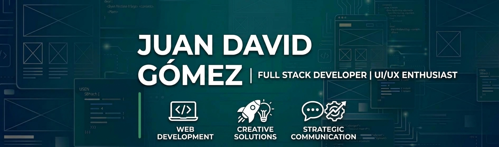

🚀 Me apasiona crear experiencias digitales que combinen tecnología, diseño y comunicación.

Actualmente estoy fortaleciendo mis habilidades en desarrollo web y construyendo proyectos que me permiten resolver problemas y convertir ideas en soluciones digitales.

🌱 Aprendiendo y practicando desarrollo Full Stack.

💻 Construyendo proyectos con React, JavaScript, Python y Flask.

🎨 Interesado en el diseño UI, la experiencia de usuario y la comunicación digital.

🎯 Mi objetivo: desarrollar soluciones web útiles, intuitivas y visualmente atractivas.

🇨🇴 Colombia.

                                              🛠️ Tecnologías y herramientas

🎨 Más allá del código

Mi formación en Comunicación Corporativa y Relaciones Públicas me aporta una perspectiva complementaria al desarrollo de software.

Me interesa conectar la lógica de la programación con el diseño visual, la identidad de marca y la experiencia de las personas.

Creo en la tecnología como una herramienta para comunicar, crear y resolver problemas.

📫 Conecta conmigo

&nbsp;&nbsp;&nbsp;&nbsp;

 

GitHub         LinkedIn

 

Gracias por visitar mi perfil.

🚀 ¡Construyamos algo increíble!

